 

VisMedS also has a <a href="https://nattawatplume.github.io/med-label-web/">label search site</a> and an <a href="https://github.com/nattawatplume/VidMedS_Website">image analyzer</a>
&nbsp;·&nbsp; Smaller builds: <a href="https://github.com/nattawatplume/portfolio">portfolio</a>, <a href="https://github.com/nattawatplume/Nattawat_Profile">profile site</a>, <a href="https://nattawatplume.github.io/Website_aniversary/">anniversary site</a>

  

  

  

