




<a href="https://market-ids.onrender.com/"></a>
<a href="https://github.com/nattawatplume/Game_My_Big_Rocket/releases/latest"></a>
<a href="https://nattawatplume.github.io/med-label-web/"></a>
<a href="https://github.com/nattawatplume/Gembot_Robot"></a>
<a href="https://github.com/nattawatplume/Xauusd_Bot"></a>
<a href="https://github.com/nattawatplume/ai_genworldGame"></a>

Source: <a href="https://github.com/nattawatplume/IDS_AI">Market IDS</a> ·
<a href="https://github.com/nattawatplume/Game_My_Big_Rocket">Rocket Rumble</a> ·
VisMedS <a href="https://github.com/nattawatplume/med-label-web">web</a>, <a href="https://github.com/nattawatplume/VidMedS_Website">analyzer</a>, <a href="https://github.com/nattawatplume/VisMedS_LineChatBot">LINE bot</a> ·
<a href="https://github.com/nattawatplume/portfolio">portfolio</a>



